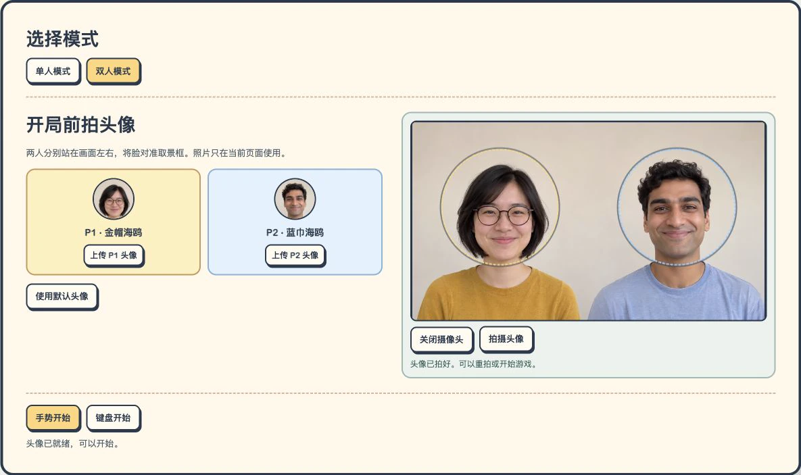
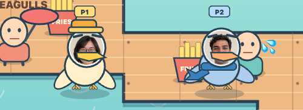

# GIVE ME YOUR FRIES! 🍟

**Game version v2.2** · **Last updated 12 November 2026, 14:13 (UTC+8)**

[English](#english) · [简体中文](#简体中文) · [Changelog / 更新日志](CHANGELOG.md)

## English

Fly a seagull around the harbor, steal fries with its feet, and deliver them to your nest. Play a solo challenge or compete with a friend on the same map.

### 1. Download and open the game

Open the [game file](GIVE_ME_YOUR_FRIES_DUO_GESTURE.html) on GitHub, choose **Download raw file**, and open the downloaded HTML in Chrome. If Chrome blocks camera access for the local file, run `python3 -m http.server 8000` in the folder containing the HTML and open the game through [localhost](http://localhost:8000/GIVE_ME_YOUR_FRIES_DUO_GESTURE.html).

### 2. Choose a mode and set your avatar

- **Solo (单人模式)** gives you one gull and one nest. In webcam mode, use the entire camera frame.
- **Duo (双人模式)** gives each player a gull and a nest on the same map. Both players share one webcam. P1 wears a gold hat and starts on the left of the webcam preview. P2 wears a blue scarf and starts on the right. Both gulls can fly anywhere on the map.
- **Take a photo.** Click **开启摄像头** to turn on the camera. In Solo, center your face in the guide. In Duo, each player lines up with their own circle. Click **拍摄头像** to take the photo, and check the portraits on the player cards. Click again to retake it. You can also upload a photo or click **使用默认头像** to use the default avatars. Photos stay in the current page session.

*The game places each captured portrait inside its gull’s face. These screenshots use generated demo portraits.*

### 3. Choose how to play

| Start option | What to do |
| --- | --- |
| **Gesture start (手势开始)** | Allow camera access and wait for the hand-tracking model to load. The first load requires internet access. In Duo, each player holds one hand on their side of the preview. The outline over each hand shows which gull it controls. |
| **Keyboard start (键盘开始)** | Start once your avatars are ready. For a quick keyboard test, select the default avatars and choose this button. |

If you are already playing with gestures and want to change controls, click **切换键盘** to switch to the keyboard.

### 4. Fly, grab fries, and return to your nest

| Action | Gesture | Keyboard |
| --- | --- | --- |
| Fly | Move your open hand. | Move with **WASD** for P1 or the **arrow keys** for P2. |
| Grab fries | Near a tray, pinch your thumb and index finger. | Near a tray, hold **F** for P1 or **K** for P2. |
| Return to the nest | With fries in your claws, open your hand while it is still in the frame. | With fries in your claws, release **F** or **K**. |

A gull can carry up to four fries. If your hand leaves the camera frame, the gull stays where it is until you bring your hand back. You can reposition trays on land with a mouse or touchscreen. A tray dropped into the water returns to its previous position. In Duo, diving into the other gull can knock fries out of its claws.

### 5. Escape the red circle and bank your score

The first fry alerts a nearby visitor. An exclamation mark appears above the visitor, and a red circle with a countdown marks the attack area. **Fly out before the countdown reaches zero.** The three rounds give you **1.65**, **1.50**, and **1.35 seconds** to escape.

A gull still inside the circle at zero is briefly stunned and drops every fry it is carrying. Once you reach your nest and deliver the fries, each one adds one point. Those points stay in your score if you are hit later.

### 6. Finish the match or play again

The three rounds last **65, 75, and 85 seconds**. When a round ends, the game shows the points earned in that round and the running total. Click **下一关** to start the next round. In Duo, the player with the higher total after all three rounds wins.

Click **再来一局** on the final screen to play again. During a match, **重新开局** restarts at round one and resets the score. **模式与头像** takes you back to setup.

## 简体中文

**当前游戏版本 v2.2** · **更新时间 2026 年 11 月 12 日 14:13（UTC+8）**

控制海鸥飞过海港，用脚抓薯条，再带回自己的巢穴计分。可以一个人挑战，也可以和朋友在同一张地图上对战。

### 1. 下载并打开游戏

打开 GitHub 上的 [游戏文件](GIVE_ME_YOUR_FRIES_DUO_GESTURE.html)，点击 **Download raw file** 下载 HTML，再用 Chrome 打开。如果 Chrome 打开本地文件时无法使用摄像头，可以在 HTML 所在的文件夹运行 `python3 -m http.server 8000`，再通过 [localhost](http://localhost:8000/GIVE_ME_YOUR_FRIES_DUO_GESTURE.html) 打开游戏。

### 2. 选择模式并设置头像

- **单人模式**有一只海鸥和一个巢穴。用手势玩时，整幅摄像头画面都可以用来控制海鸥。
- **双人模式**有两只海鸥、两个巢穴。两人共用一个摄像头。P1 是金帽海鸥，从取景框左侧入镜，P2 是蓝巾海鸥，从右侧入镜。两只海鸥都可以飞遍同一张地图。
- **拍摄头像。** 点击**开启摄像头**。单人把脸对准中间的圆框，双人各自对准左右两侧的圆框。点击**拍摄头像**后，可以在玩家卡片里查看结果，再点一次可以重拍。也可以上传照片，或点击**使用默认头像**跳过拍照。照片只在当前页面使用。

*进入游戏后，拍下来的脸会显示在对应的海鸥头上。配图使用生成的演示头像。*

### 3. 选择手势或键盘

| 开始方式 | 怎么操作 |
| --- | --- |
| **手势开始** | 允许摄像头权限，等待手势模型加载。首次加载需要联网。双人各在取景框自己的半边伸出一只手，描线颜色对应各自的海鸥。 |
| **键盘开始** | 头像准备好就可以开始。想先用键盘试玩，可以选择默认头像，再点这个按钮。 |

手势游玩过程中，可以点击**切换键盘**改用键盘。

### 4. 飞行、抓薯条和回巢

| 动作 | 手势 | 键盘 |
| --- | --- | --- |
| 飞行 | 张开手掌并移动。 | P1 用 **WASD**，P2 用**方向键**。 |
| 抓薯条 | 飞到薯条盒附近，用拇指和食指捏合。 | 靠近薯条盒时，P1 按住 **F**，P2 按住 **K**。 |
| 回巢 | 抓到薯条后，手留在镜头内并松开手指。 | 抓到薯条后松开 **F** 或 **K**。 |

海鸥一次最多抓四根薯条。手离开镜头时，海鸥会停在原地，手重新入镜后可以继续飞行。薯条盒可以用鼠标或触屏在陆地上摆放，拖到海里会回到原位。双人模式下，俯冲撞到对手可以撞掉对方脚上的薯条。

### 5. 飞出红圈，把薯条带回巢穴

抓到第一根薯条时，附近游客头顶会亮起叹号，地图上出现红圈和倒计时。**倒计时归零前飞出红圈。** 三关依次有 **1.65 秒、1.50 秒和 1.35 秒**可以撤离。

归零时还在圈内的海鸥会被短暂击晕，脚上的薯条全部掉落。把薯条带回自己的巢穴后，每根计一分。已经入巢的分数会保留。

### 6. 结算、进入下一关和重玩

三关分别限时 **65、75、85 秒**。每关结束时，游戏会显示本关得分和累计分数。点击**下一关**继续。双人模式下，三关累计分数更高的一方获胜。

结算后可以点击**再来一局**。游戏过程中点击**重新开局**会回到第一关并重置分数，点击**模式与头像**可以回到开局设置。
