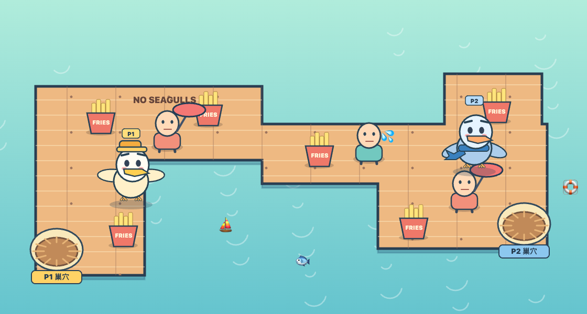
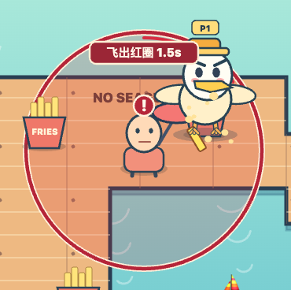

# GIVE ME YOUR FRIES! 🍟

**Game version v2.2** · **Last updated 12 November 2026, 13:48 (UTC+8)**

[English](#english) · [简体中文](#简体中文) · [Changelog / 更新日志](CHANGELOG.md)

## English

Fly a seagull across the harbor, grab fries with its feet, and bring them back to your nest to score. Play solo or share one webcam and one map with a second player.

*P1 wears a gold hat. P2 wears a blue scarf. In Duo mode, both gulls can fly anywhere on the map.*

### How to play

1. Open the [game file](GIVE_ME_YOUR_FRIES_DUO_GESTURE.html), choose **Download raw file**, and open the downloaded HTML in Chrome.
2. Choose **Solo** or **Duo**. Take a webcam photo, upload a portrait, or use the default avatar. The game keeps portraits in the current page session.
3. Start with the webcam or keyboard. For webcam play, allow camera access. The first load of the MediaPipe hand-tracking model requires an internet connection.

| Action | Webcam | Keyboard |
| --- | --- | --- |
| Fly | Move an open hand. Solo uses the full camera frame. In Duo, P1 starts on the left and P2 on the right. | P1 uses **WASD**. P2 uses the **arrow keys**. |
| Grab fries | Pinch your thumb and index finger near a tray. | Hold **F** for P1 or **K** for P2 near a tray. |
| Return to your nest | Release the pinch while your hand is still in view. | Release **F** or **K** while carrying fries. |

If your hand leaves the camera frame, your gull stays where it is and keeps its fries. You can reposition trays on land with a mouse or touchscreen. A tray dropped in the water returns to its previous position. In Duo mode, a diving gull can knock fries out of the other gull’s claws.

### Visitor defense

Your first fry from a tray alerts a nearby visitor. An exclamation mark appears above the visitor, and a red circle marks the attack area. **Fly out before the countdown ends.** The three rounds give you 1.65, 1.50, and 1.35 seconds to escape.

*A gull still inside the circle at zero is stunned and drops every fry it is carrying. Fries already delivered to a nest stay in the score.*

If Chrome blocks camera access for the local file, run `python3 -m http.server 8000` from the folder containing the HTML and open the game through [localhost](http://localhost:8000/GIVE_ME_YOUR_FRIES_DUO_GESTURE.html).

## 简体中文

**当前游戏版本 v2.2** · **更新时间 2026 年 11 月 12 日 13:48（UTC+8）**

控制海鸥飞过海港，用脚抓薯条，再带回自己的巢穴计分。可以一个人玩，也可以两人共用一个摄像头，在同一张地图上对战。

*P1 是金帽海鸥，P2 是蓝巾海鸥。双人模式下，两只海鸥都可以飞遍整张地图。*

### 怎么开始

1. 打开 [游戏文件](GIVE_ME_YOUR_FRIES_DUO_GESTURE.html)，点击 **Download raw file** 下载 HTML，再用 Chrome 打开。
2. 选择**单人**或**双人**模式，然后拍摄、上传或选择默认头像。头像只在当前页面使用。
3. 选择手势或键盘开始。用手势玩时需要允许摄像头权限，首次加载 MediaPipe 手势模型需要联网。

| 动作 | 手势 | 键盘 |
| --- | --- | --- |
| 飞行 | 张手移动。单人用整个画面，双人开局时 P1 把手放在左侧，P2 放在右侧。 | P1 用 **WASD**，P2 用**方向键**。 |
| 抓薯条 | 飞到薯条盒附近，用拇指和食指捏合。 | P1 按住 **F**，P2 按住 **K**。 |
| 回巢交货 | 手留在镜头内，松开捏合的手指。 | 抓到薯条后松开 **F** 或 **K**。 |

手离开镜头时，海鸥会停在原地，脚上的薯条会保留。薯条盒可以用鼠标或触屏在陆地上摆放，拖到海里会回到原位。双人模式下，俯冲撞到对手会让对手掉落脚上的薯条。

### 游客塔防

海鸥抓到第一根薯条后，附近游客头顶会亮起叹号，地图上出现红圈和倒计时。**倒计时结束前飞出红圈。** 三关依次有 1.65 秒、1.50 秒和 1.35 秒可以撤离。

*倒计时归零时还在圈内的海鸥会被击晕，脚上的薯条全部掉落。已经带回巢穴的分数保留。*

如果 Chrome 打开本地文件时无法使用摄像头，可以在 HTML 所在的文件夹运行 `python3 -m http.server 8000`，再通过 [localhost](http://localhost:8000/GIVE_ME_YOUR_FRIES_DUO_GESTURE.html) 打开游戏。
